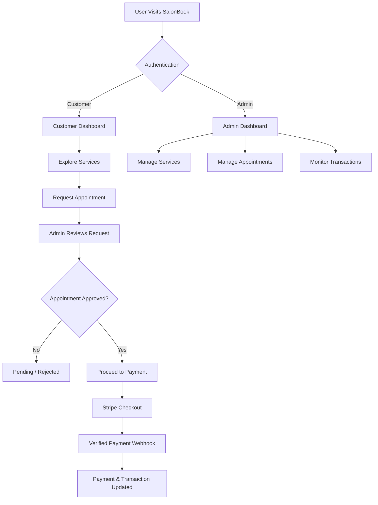

# SalonBook – Salon Appointment Booking Platform

SalonBook is a full-stack salon appointment booking platform that connects customers with salon services through a simple and convenient digital experience. It provides separate functionalities for customers and administrators to manage appointments, services, and payments.

## 👥 System Actors

### 1. Customer
- Register and log in to the platform.
- Explore available salon services.
- View service details and pricing.
- Request salon appointments.
- Track appointment status.
- Pay for confirmed appointments.
- View payment history.
- Manage personal profile.

### 2. Administrator
- Access the admin dashboard.
- Add, update, and delete salon services.
- Manage customer appointments.
- Confirm or manage appointment requests.
- Monitor payment transactions.
- Manage personal profile.

## 🔄 Application Workflow

## ✨ Core Features

- **Authentication & Authorization:** Secure authentication with customer and admin role-based access.
- **Service Management:** Complete salon service management for administrators.
- **Appointment Booking:** Customers can request and manage salon appointments.
- **Appointment Management:** Administrators can review and manage booking requests.
- **Online Payment:** Secure payment processing through Stripe Checkout.
- **Transaction Management:** Store and monitor verified payment transactions.
- **Customer Dashboard:** Personalized dashboard for appointments and payment history.
- **Admin Dashboard:** Centralized management of services, appointments, and transactions.
- **Profile Management:** Update and manage user information.
- **Image Upload:** Upload service images using ImgBB.
- **Responsive Interface:** User-friendly experience across different screen sizes.

## 🛠️ Technologies Used

| Category | Technologies |
|---|---|
| Frontend | Next.js, React, TypeScript |
| Styling | Tailwind CSS, DaisyUI |
| Authentication | Better Auth |
| Backend | Node.js, Express.js |
| Database | MongoDB |
| Authorization | JWT (JOSE) |
| Payment | Stripe Checkout, Stripe Webhooks |
| Image Hosting | ImgBB |
| Development Tools | Git, GitHub, ESLint |

## 🏗️ System Architecture

SalonBook follows a client-server architecture.

- **Frontend:** Handles user interfaces, navigation, dashboards, and client-side interactions.
- **Backend:** Provides RESTful APIs, authentication verification, authorization, and business logic.
- **Database:** MongoDB stores users, services, appointments, and transactions.
- **Payment Gateway:** Stripe handles secure payment processing, while verified webhooks confirm successful transactions.

---

**SalonBook** – Simplifying Salon Appointments.